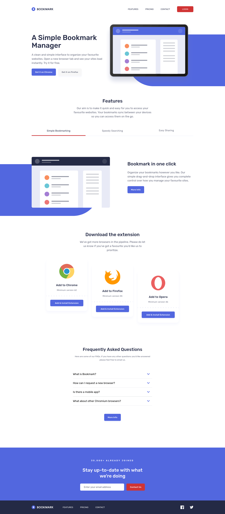

# Frontend Mentor - Bookmark landing page solution

This is a solution to the [Bookmark landing page challenge on Frontend Mentor](https://www.frontendmentor.io/challenges/bookmark-landing-page-5d0b588a9edda32581d29158). Frontend Mentor challenges help you improve your coding skills by building realistic projects.

## Table of contents

- [Overview](#overview)
  - [The challenge](#the-challenge)
  - [Screenshot](#screenshot)
  - [Links](#links)
- [My process](#my-process)
  - [Built with](#built-with)
  - [What I learned](#what-i-learned)
  - [Continued development](#continued-development)
  - [Useful resources](#useful-resources)
  - [AI Collaboration](#ai-collaboration)
- [Author](#author)

## Overview

### The challenge

Users should be able to:

- View the optimal layout for the site depending on their device's screen size
- See hover states for all interactive elements on the page
- Receive an error message when the newsletter form is submitted if:
  - The input field is empty
  - The email address is not formatted correctly

### Screenshot



### Links

- Solution URL: [Github](https://github.com/VirginiaPat/bookmark-landing-page.git)
- Live Site URL: [Netlify](https://bookmark-virgi.netlify.app/)

## My process

### Built with

- Semantic HTML5 markup
- Tailwind CSS
- Vanilla JavaScript (ES modules)
- Native `<dialog>` for the full-screen mobile menu
- Web Animations API for the tabs
- Flexbox and CSS Grid
- Mobile-first workflow

### What I learned

**A native `<dialog>` for the mobile menu.** `showModal()` gives the top layer, focus trapping and the Esc key for free. For the fade in and out I used `@starting-style` and `allow-discrete` transitions, so the dialog stays rendered while it fades. The menu also closes when a link is clicked and when the viewport reaches the desktop breakpoint (`matchMedia`).

**Accessible tabs.** Roving `tabindex`, arrow keys, Home and End. The sliding red underline is measured with `getBoundingClientRect` and animated with the Web Animations API. The panels cross-fade and the container height is animated too. Everything respects `prefers-reduced-motion`.

**An accordion without animating `height`.** The FAQ panel animates `grid-template-rows` from `0fr` to `1fr`, and uses `visibility: hidden` while closed so the hidden content is not reachable by keyboard or screen readers. The button's `aria-expanded` is the single source of truth: JavaScript only toggles it and the CSS reads it, so the state can never get out of sync.

```css
.faq-content {
  @apply grid;
  grid-template-rows: 0fr;
  visibility: hidden;
  transition:
    grid-template-rows 0.3s ease,
    visibility 0.3s;
}

/* The button's aria-expanded is the single source of truth */
.faq-container:has([aria-expanded="true"]) .faq-content {
  grid-template-rows: 1fr;
  visibility: visible;
}
```

**An accessible newsletter form.** A real `<form novalidate>` that validates on `submit` (so Enter works), with `type="email"`, `required` and a `pattern`. The error message is an empty `role="alert"` paragraph that JavaScript fills in, `aria-invalid` on the input drives the error styling, and a `role="status"` paragraph announces success to screen readers. Tailwind's `peer-*` and `has-focus-visible` variants show the error icon and the focus ring without extra JavaScript.

**Structuring the JavaScript.** A small `dom.js` with lookup helpers that throw descriptive errors when an element is missing, and a `startFeature` wrapper so that one feature failing to start does not stop the others.

```js
const startFeature = (name, init) => {
  try {
    init();
  } catch (error) {
    console.error(`[${name}] failed to start:`, error);
  }
};
```

**Checking accessibility with numbers, not by eye.** I computed the contrast ratio of every text and background combination, including the ones that use opacity. That led to using a single 70% opacity for secondary text and adding a lighter red (`accent-light`) just for hover states on the dark footer. I also learned that the red and the blue of this design have almost the same luminance, so red-on-blue details are not enough on their own to carry meaning.

### Continued development

- Self-host the Rubik font instead of loading it from Google Fonts (privacy / GDPR). I tried it with Fontsource and could not get it working this time, so I want to revisit it in another project.
- Show a "demo project" notice when a placeholder link (pricing, login, social links, store buttons) is clicked.
- Show a visible success message after the form is submitted (right now it is announced to screen readers only) and connect the form to a real endpoint.
- Replace the CSS filters on the icons with inline SVGs that use `currentColor`, which is more precise.
- Add Open Graph meta tags so the link shows a preview card when shared

### Useful resources

- [WAI-ARIA Authoring Practices: Tabs pattern](https://www.w3.org/WAI/ARIA/apg/patterns/tabs/) - the keyboard behavior and roles I followed for the tabs.
- [WAI-ARIA Authoring Practices: Accordion pattern](https://www.w3.org/WAI/ARIA/apg/patterns/accordion/) - how the FAQ buttons, `aria-expanded` and `aria-controls` fit together.
- [WebAIM Contrast Checker](https://webaim.org/resources/contrastchecker/) - for checking text and background combinations.
- [Tailwind CSS documentation](https://tailwindcss.com/docs) - especially the pages about variants (`peer`, `group`, `has`, `aria-*`) and theme variables.

### AI Collaboration

I used Claude while building this project, mainly as a reviewer and a tutor.

## Author

- Frontend Mentor - [@VirginiaPat](https://www.frontendmentor.io/profile/VirginiaPat)
- GitHub - [VirginiaPat ](https://github.com/VirginiaPat)
- Netlify - [VirginiaPat](https://app.netlify.com/teams/virginia-patrika/sites)
